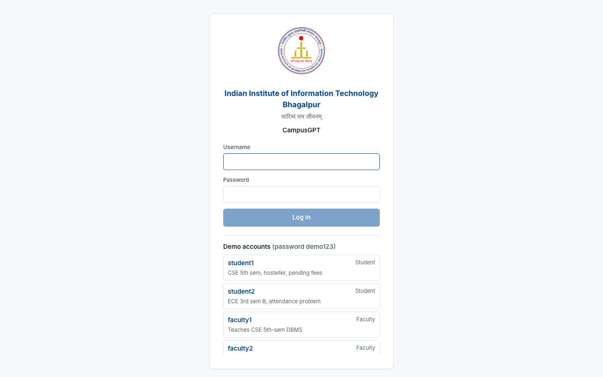
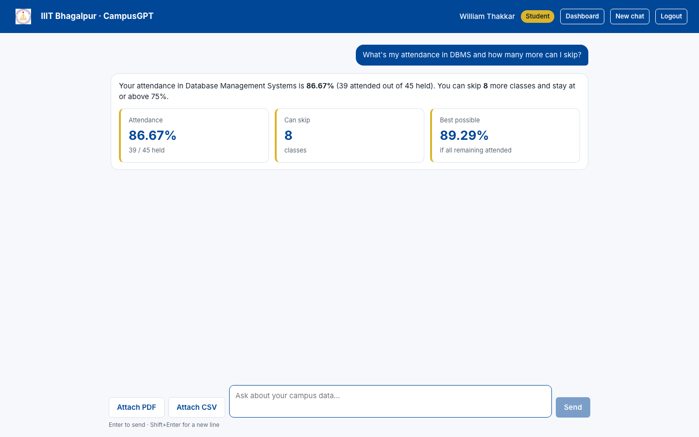
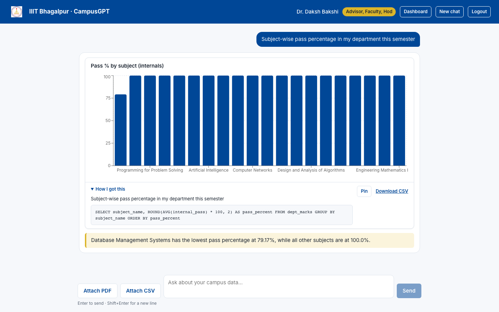
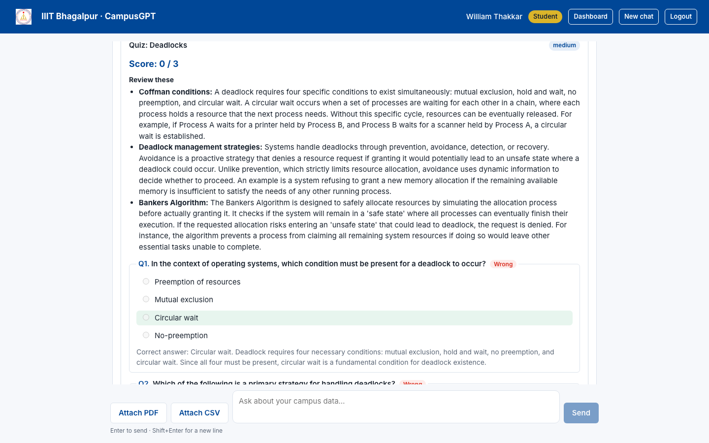
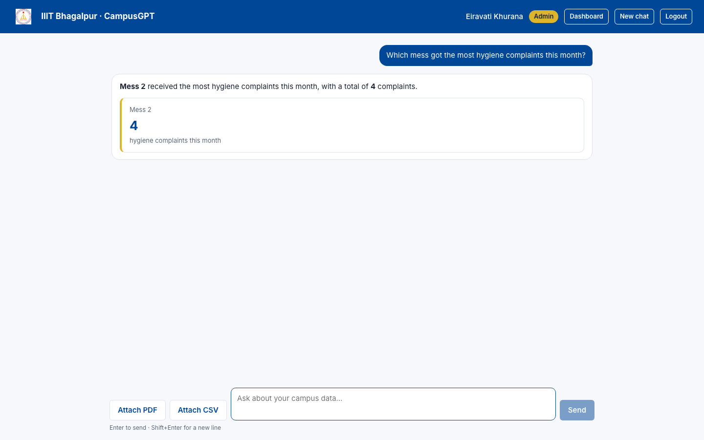
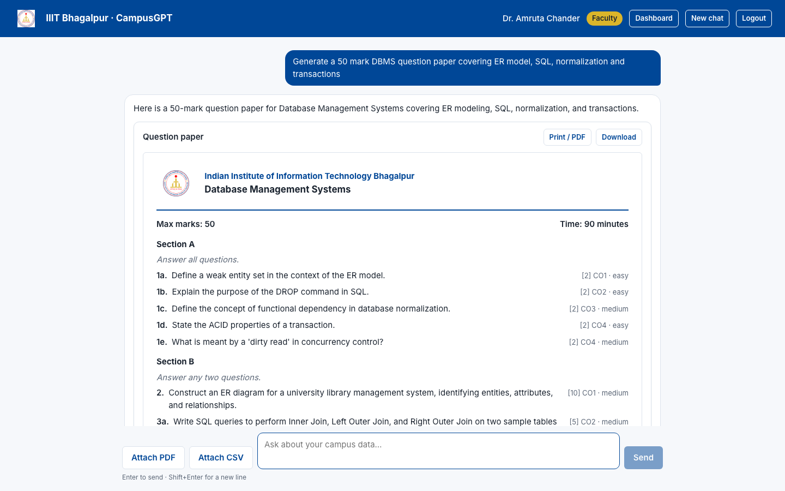
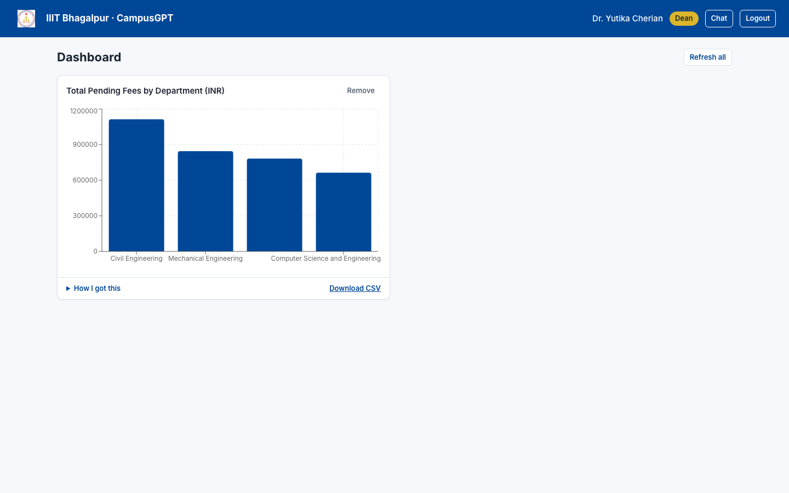
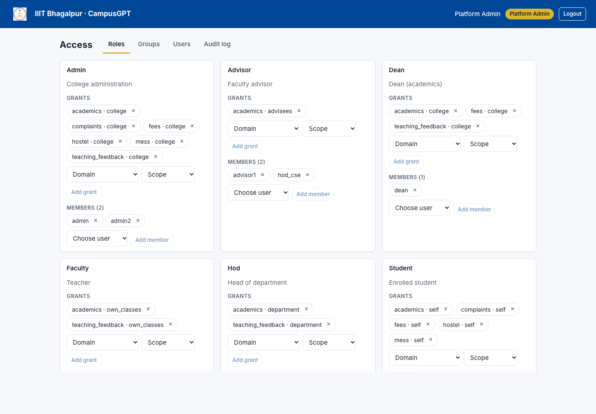

# CampusGPT

An AI assistant for the IIIT Bhagalpur student/admin portal (minor project). Faculty, HODs, the Dean and admins ask questions in English, Hindi or Hinglish and get live tables and charts. Students check their own records and learn with explanations, quizzes and flashcards. Every answer is computed by SQL over a read-only, role-restricted MySQL database, and the executed SQL is shown under each answer.

The full specification is in [PRD.md](PRD.md) / [PRD.docx](PRD.docx). Design choices are in [docs/DECISIONS.md](docs/DECISIONS.md), progress in [docs/TASKS.md](docs/TASKS.md) and measured quality in [docs/evaluation-report.md](docs/evaluation-report.md).

## Screenshots

| | |
|---|---|
|  Login with demo accounts |  Student: attendance and skip calculator |
|  HOD: chart, insight and "How I got this" |  Quiz with re-explained wrong answers |
|  Admin: complaint insights |  Faculty: question paper with CO mapping |
|  Saved dashboard |  Platform admin: access management |

A ready-made presentation flow is in [docs/DEMO.md](docs/DEMO.md).

## Stack

React 19 + TypeScript + Vite + OpenUI (frontend) · FastAPI + Strands Agents on Python 3.12, managed with uv (backend) · MySQL 8.4 in Docker · Gemini (free tier) by default, switchable to Amazon Bedrock through `.env`.

## Features

- Text-to-SQL answers as charts, tables and stat cards, with "How I got this" (the executed SQL), CSV download and follow-up questions.
- Student records: attendance with skip calculator, marks, CGPA, fees, exams, hostel, mess, complaints.
- Learning: explanations, quizzes (wrong answers re-explained and brought back later for revision), flashcards, quiz from a PDF, exam study plan.
- Feedback and complaint insights (AI-tagged sentiment and themes, recurring issues), at-risk students with drafted messages.
- Faculty tools: question paper generator with CO mapping, NAAC/NBA report draft.
- Saved dashboard (pin any chart or table), CSV upload to ask questions about your own data, web search with sources.
- Role-based access managed by a platform admin (roles, groups, per-user grants, audit log).

## Prerequisites

- Docker Desktop (running)
- [uv](https://docs.astral.sh/uv/) (`brew install uv`)
- Node.js 20+ (`nvm install 22`)
- A free Gemini API key from https://aistudio.google.com/apikey

## Setup

```bash
cp .env.example .env
# edit .env: set GEMINI_API_KEY and replace every change-me value
docker compose up -d                                  # MySQL on localhost:3307

cd backend
uv sync
uv run python scripts/generate_mock_data.py           # schema data, planted patterns, demo users (~5 s)
uv run python scripts/tag_text.py                     # LLM tags feedback + complaints (one-off, a few minutes)
uv run uvicorn app.main:app --reload --port 8000

cd ../frontend                                        # in a second terminal
npm install
npm run dev                                           # http://localhost:5173
```

## Demo logins

All demo accounts use the password `demo123`.

| Username | Role | Note |
|---|---|---|
| student1 | Student | CSE 5th sem, section A (the DBMS section), hosteller in Boys Hostel B, pending fees, has a complaint |
| student2 | Student | ECE 3rd sem section B, attendance problem, day scholar |
| faculty1 | Faculty | Teaches CSE 5th-sem DBMS (section A) and Operating Systems |
| faculty2 | Faculty | CSE, member of group "Exam Cell – CSE" (sees CSE-wide academics) |
| advisor1 | Advisor | CSE advisor with several at-risk advisees |
| hod_cse | HOD | Head of CSE |
| dean | Dean | College-wide academics and fees |
| admin | Admin | All college data |
| platform_admin | Platform Admin | Access page only. Password = `PLATFORM_ADMIN_PASSWORD` in `.env` |

## Free tier notes

The project runs on the free Google AI Studio tier only. Its limits (per model, per project) are about 15 requests per minute and 500 per day for Flash Lite, and 30 per minute and 14,400 per day for Gemma 4. Limits reset at midnight Pacific time (about 1:30 pm IST).

- One chat question uses 3–4 model calls, so expect roughly 100–150 questions per day.
- `MODEL_FALLBACK_IDS` in `.env` lists backup models. When a model is overloaded (503) or out of quota (429), the app moves to the next one at once.
- If answers are slow, Google's free servers are busy. Wait a minute and ask again.
- Before a live demo, avoid running the evals the same day, so the daily quota is free for the demo.
- After re-running `generate_mock_data.py`, run `scripts/tag_text.py` again. Regenerating wipes the tags.

## Tests, lint and evals

```bash
cd backend
uv run pytest                                         # unit + integration (needs the Docker DB with mock data)
uv run ruff check . && uv run ruff format --check .
uv run python evals/run_all.py                        # all eval suites against the real model
uv run python evals/run_all.py --suite sql            # one suite (sql, isolation, guardrails, routing, charts, quiz, tagging)
uv run python scripts/build_eval_report.py            # docs/evaluation-report.md + .docx from the latest results

cd ../frontend
npm run lint && npm run typecheck && npm test
```

On the free tier, run evals with `EVAL_MIN_INTERVAL_SECONDS=20` (one question every 20 s). A full run takes about 2–3 hours and uses most of a day's quota.

## Managing access (platform admin)

Roles, groups and grants live in the `campus_auth` schema, loaded from `backend/app/access/policy.yaml`. Change them on the Access page (log in as `platform_admin`) or with the CLI:

```bash
cd backend
uv run python scripts/access.py list
uv run python scripts/access.py create-group "Timetable Committee"
uv run python scripts/access.py add-member "Timetable Committee" faculty1
uv run python scripts/access.py grant user faculty1 hostel college
uv run python scripts/access.py effective faculty1
```

Changes take effect at the user's next login. A grant that would break the department wall (college-wide academics or teaching feedback for anyone but the Dean or Admin) is rejected.

## API

OpenAPI docs: http://localhost:8000/docs. A Postman collection and environment are in [docs/api/](docs/api/). Regenerate them with `uv run python scripts/build_postman.py` after changing routes.

## How data isolation works

1. Login resolves the user's grants (roles + groups + per-user grants) into an allow-list of logical views.
2. The model only ever sees those view names and descriptions. It must call `describe_view` before using a view.
3. Every model query goes through the sqlglot guard: one SELECT, only allowed views, no schema names, no dangerous functions or variables, LIMIT 500.
4. The scope rewrite replaces each view with its SQL template bound to the session's student, faculty or department id, so the model can't remove the filter.
5. The query runs as `campus_ro`, which has SELECT on `campus` only and no access at all to `campus_auth`.

## Switching to Bedrock

Set `MODEL_PROVIDER=bedrock`, `AWS_REGION`, `MODEL_ID_MAIN` and `MODEL_ID_FAST` in `.env` and make AWS credentials available. No code changes are needed.
